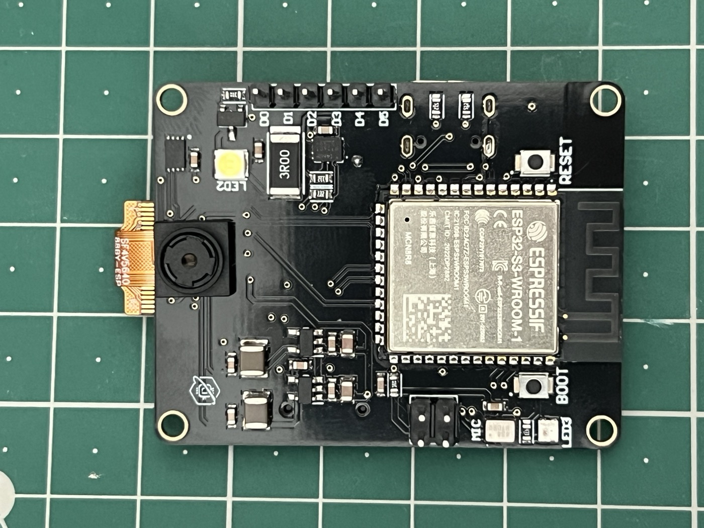

<Frame>
  
</Frame>

Every item on this page is sourced from the working firmware, the approved schematic or a component datasheet. Anything that could not be verified is marked **not yet verified**. This is not a manufacturing document: it has no PCB layout information, exact power-rail routing or purchasable parts list.

## Processor

| | |
| - | - |
| Module | ESP32-S3-WROOM-1-N16R8 |
| Flash | 16 MB |
| PSRAM | 8 MB, OPI mode |
| Cores | Dual-core Xtensa LX7 (per the ESP32-S3 module) |

Flash and PSRAM sizes come from the module's part number (`N16R8`) and match the firmware's documented build settings (`PSRAM: OPI PSRAM / Enabled`, `Flash Size: 16MB`).

## Camera interface

| | |
| - | - |
| Sensor | OV5640, 5 MP (2592×1944 array), 1/4" optical format |
| Connector | 24-pin FPC (board side: FFC2B28-24-G) |
| Interface | 8-bit parallel data bus plus SCCB (I2C) for sensor control, shared with the board's main I2C bus |
| Lens | 3.0 mm EFL, F2.2, 76.6° field of view (per the camera module datasheet) |

See [Cameras](/hardware/cameras), the [Camera guide](/guides/camera) and the [Pinout](/hardware/pinout).

## Wireless

- **Wi-Fi:** the ESP32-S3's built-in radio, used by the firmware for camera streaming and the onboard HTTP server.
- No Bluetooth functionality is implemented in the current firmware. See [Wi-Fi and Bluetooth](/guides/wifi-bluetooth).
- Wireless range, throughput and power figures have not been measured.

## USB

| | |
| - | - |
| Connector | USB-C |
| Mode | Native ESP32-S3 USB, used as a USB-CDC serial port (`USB CDC On Boot: Enabled`) |
| ESD protection | USBLC6-2SC6 |
| Overcurrent protection | 2 A resettable fuse on the USB-C power path (per schematic) |

## Power

- **Battery input:** 3.7 V Li-Po on a 2-pin JST-style connector
- **Charging:** MCP73831-based Li-Po charge management (the schematic labels it "Programmable current charging, 500mA")
- **Reverse-polarity protection:** P-channel MOSFET on the battery input
- **Regulators:** a 3.3 V main rail plus separate 2.8 V and 1.5 V rails for the camera module

Exact input voltage limits, maximum charge and discharge current, and battery runtime have not been measured.

## Onboard sensors and peripherals

| Component | Part | Bus | Verified via |
| - | - | - | - |
| IMU | ICM-42670-P | I2C | Schematic, firmware `imu` command, photo |
| Secure element | ATECC608B-MAHDA-S | I2C | Schematic, firmware `crypto`, `atecc` and `secure` commands, photo |
| I/O expander | PCA9685BS,118 (16-channel PWM/LED driver) | I2C | Schematic, firmware `pca_scan` command, photo |
| Microphone | ICS-43434 (I2S MEMS) | I2S | Schematic, firmware `mic` command |
| Storage | microSD, push-push slot | SPI | Schematic, firmware `sd` and `sd_test` commands, photo |

## LEDs and buttons

- **Status LED:** one addressable RGB LED (WS2812B) on GPIO1
- **Auxiliary LED:** one 1 W high-power LED, MOSFET-switched on GPIO48 (on/off, blink and PWM dimming in firmware)
- **RESET:** hardware reset (EN)
- **BOOT:** bootloader-entry strap (GPIO0), the standard ESP32-S3 boot-mode button

## Expansion

- **I2C header:** 4-pin, breaks out the shared SDA/SCL bus used by the camera SCCB, IMU, secure element and I/O expander
- **UART header:** 2×2, a hardware UART separate from the USB-C serial console. Exact GPIO assignment: not yet verified
- **GPIO/PWM expansion header:** 6-pin, silkscreened "GPIO EXPANDER". These are PCA9685 channels LED0 to LED5, controlled over I2C, not direct ESP32-S3 pins

<Warning>
  The camera's SCCB lines share GPIO17 and GPIO18 with the main I2C bus. Read the [Camera guide](/guides/camera#known-limitations) before testing the IMU, secure element or expander right after using the camera.
</Warning>

## Not yet published

- Board dimensions and mounting-hole spacing
- Whether the silkscreen text "Protonverse 0.10" denotes a specific hardware revision
- The production bill of materials and PCB layout files (intentionally not published)

A parts-level BOM and the full schematic are on the [Downloads](/resources/downloads) page.
