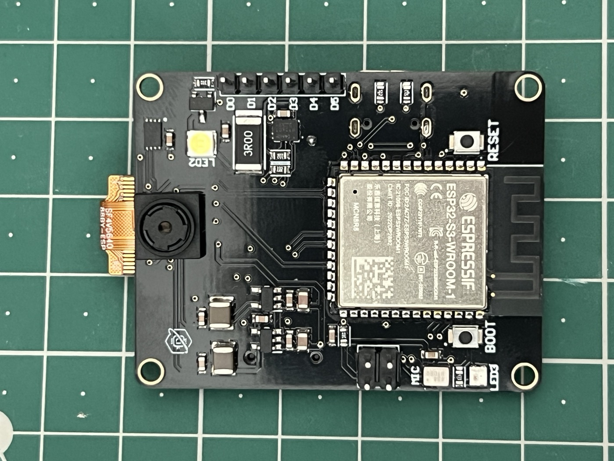

<Frame>
  
</Frame>

**Proton AI Core Vision+** is an ESP32-S3 camera development board built by [Protonverse Labs](https://github.com/Protonverse-Labs). It puts a tested OV5640 camera, an IMU, a secure element, a 16-channel PWM/GPIO expander, an I2S microphone, microSD storage, Li-Po charging and status LEDs on one board, so a camera-based prototype starts from working hardware instead of a breadboard of separate modules.

<Note>
  **Current stage: working hardware prototype.** Physical boards exist, have been tested, and run the firmware published on GitHub. The board is not yet in mass production. [Project status](/resources/project-status) lists exactly what has and has not been verified.
</Note>

## At a glance

| | |
| - | - |
| MCU | ESP32-S3-WROOM-1-N16R8 (dual-core, 16 MB flash, 8 MB PSRAM) |
| Camera | OV5640, 5 MP, 24-pin FPC connector |
| Connectivity | Wi-Fi (ESP32-S3 built-in) |
| USB | USB-C, native USB (CDC serial) |
| Onboard sensors | IMU (ICM-42670-P), I2S microphone (ICS-43434), secure element (ATECC608B) |
| Expansion | PCA9685 16-channel PWM/GPIO expander, I2C header, UART header |
| Storage | microSD (SPI) |
| Power | USB-C, or 3.7 V Li-Po with onboard charging |
| Firmware | Arduino (ESP32 Arduino core), open source |

## Start here

<CardGroup cols={2}>
  <Card title="Quick Start" icon="rocket" href="/getting-started/quickstart">
    Flash the firmware and take your first photo in a few steps.
  </Card>
  <Card title="Hardware overview" icon="microchip" href="/getting-started/hardware-overview">
    Every verified component and subsystem on the board.
  </Card>
  <Card title="Pinout" icon="plug" href="/hardware/pinout">
    GPIO assignments and the shared I2C bus.
  </Card>
  <Card title="Camera guide" icon="camera" href="/guides/camera">
    Capture JPEG frames and stream MJPEG over Wi-Fi.
  </Card>
  <Card title="Firmware guide" icon="terminal" href="/guides/firmware">
    Architecture and the full serial command reference.
  </Card>
  <Card title="Example projects" icon="code" href="/guides/examples">
    Small sketches for camera, Wi-Fi streaming and LEDs.
  </Card>
</CardGroup>

<Card title="Protonverse Studio" icon="window" href="/studio/overview">
  A browser-based development environment for Proton AI Core boards, with a demo you can try without a board.
</Card>

## What this board is, and is not

It is a good starting point if you are building:

- a camera-enabled embedded or robotics prototype that also needs motion sensing or servo/PWM control
- a project that wants a hardware secure element without adding a second board
- anything where you would otherwise wire an ESP32-S3 board, a camera breakout, an IMU breakout and an I/O expander together by hand

It does **not** currently include on-device AI acceleration or a neural processing unit, and the current firmware does not run any on-device inference. See [AI inference](/guides/ai-inference) for details and the [Roadmap](/resources/roadmap) for what is planned.

## Open source

The firmware and example sketches are MIT licensed. The schematic, parts-level BOM and documentation are CERN-OHL-P v2. PCB layout files, Gerbers and the production BOM are intentionally not published. Everything is in the [GitHub repository](https://github.com/Protonverse-Labs/proton-ai-core-vision-plus), and the [Downloads](/resources/downloads) page links the individual files.
